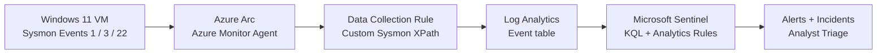

# SOC Detection & Incident Response Home Lab

**Microsoft Sentinel · KQL · Sysmon · Azure Arc · Windows 11 · MITRE ATT&CK**

A hands-on blue-team project that sends Windows endpoint telemetry to Microsoft Sentinel, builds and tunes KQL detections, triggers scheduled alerts, and investigates authorized test activity from initial execution through incident closure.

> **Scope:** Personal training lab. Every simulation described here was intentionally harmless and authorized. The detection of a suspicious *pattern* does **not** mean malware or compromise was present.

## Results at a glance

| Outcome | Verified result |
|---|---|
| Endpoint | Windows 11 Enterprise VM in Oracle VirtualBox, running Sysmon |
| Cloud SIEM | Microsoft Sentinel + Log Analytics via Azure Arc and Azure Monitor Agent |
| Data collected | Sysmon Event IDs **1**, **3**, **22** |
| Ingestion validation | **171** matching Sysmon events in the initial 24-hour query; **728** in a later sample |
| KQL content | **7 saved threat-hunting/investigation queries** plus an ingestion validation file |
| Custom automated detections | **3** scheduled analytics rules |
| Incidents | **3** generated automatically, investigated and closed as **Benign Positive** |
| Detection tuning | Compared two benign Rundll32 executions and refined a lab-specific exclusion |

### Evidence highlights

| Evidence | What it proves |
|---|---|
| [Sysmon ingestion results](screenshots/04-detections/01-sysmon-event-summary.png) | Endpoint telemetry reached Sentinel's `Event` table |
| [Enabled PowerShell detection rule](screenshots/04-detections/02-powershell-rule-enabled.png) | A KQL hunt was converted into a scheduled analytics rule |
| [PowerShell incident closure](screenshots/04-detections/03-incident1-benign-positive-closed.png) | Analyst review, documented disposition and closure |
| [Reconnaissance incident notes](screenshots/05-incident-investigations/01-incident2-closure-notes.png) | User/network discovery investigated and classified |
| [DNS incident closure](screenshots/05-incident-investigations/03-incident3-benign-positive-closed.png) | Repeated unsuccessful DNS queries detected and triaged |
| [Rundll32 tuning result](screenshots/05-incident-investigations/04-rundll32-tuned-zero-results.png) | Benign lab command lines excluded from a hunt |

## Architecture



The VM used **VirtualBox NAT**, which allows controlled benign test traffic but is **not** a fully isolated malware-analysis network. Only selected **Sysmon Operational** events were forwarded to Azure; the earlier Windows Security log exercise was local.

[Architecture and collection details](docs/ARCHITECTURE.md) · [Azure setup](docs/03-AZURE-SENTINEL-INGESTION.md)

## Detection and investigation cases

| Scenario | Sysmon telemetry | Detection / analyst outcome | ATT&CK context |
|---|---|---|---|
| [Encoded PowerShell](reports/01-encoded-powershell.md) | Event ID 1 | Detected benign `-EncodedCommand` simulation; **Incident #1**, Medium, closed benign positive | **T1059.001** |
| [Windows reconnaissance](reports/02-windows-reconnaissance.md) | Event ID 1 | Reconstructed `powershell.exe → cmd.exe → whoami.exe/ipconfig.exe`; **Incident #2**, Low, closed benign positive | **T1033**, **T1016** |
| [Lab DNS lookup pattern](reports/03-dns-lookup-pattern.md) | Event ID 22 | Matched three distinct failed queries to reserved test subdomains; **Incident #3**, Low, closed benign positive | No attack technique asserted |
| [Rundll32 detection tuning](reports/04-rundll32-tuning.md) | Event ID 1 | Compared legitimate Control Panel launches; refined a manual hunt to exclude those exact test commands; **no automated incident** | **T1218.011** dual-use utility |

See the [full incident response report](reports/PHASE5-INCIDENT-RESPONSE-REPORT.md) for evidence, analyst conclusions, limitations and follow-up recommendations.

## KQL queries

- [Sentinel ingestion validation](queries/phase3-ingestion-validation.kql)
- [PowerShell execution hunt](queries/phase4-suspicious-powershell.kql)
- [DNS process attribution](queries/phase4-dns-process-investigation.kql)
- [Network connection investigation](queries/phase4-network-connection-investigation.kql)
- [Reconnaissance process hunt](queries/phase5-recon-process-hunt.kql)
- [Lab DNS lookup threshold](queries/phase5-dns-lookup-burst-lab.kql)
- [Rundll32 process hunt](queries/phase5-rundll32-process-hunt.kql)
- [Rundll32 tuned hunt](queries/phase5-rundll32-tuned-hunt.kql)

These are educational queries tested on one endpoint, not deploy-as-is production detections. Parsing `RenderedDescription` depends on Sysmon event formatting; production collection should prefer normalized, structured fields where available.

## Deployment and reproducibility

1. Prepare a Windows 11 test VM and install Sysmon using the [example lab configuration](config/sysmon-config.xml). Review and tune collection volume before any cloud ingestion.
2. Set up an Azure Log Analytics workspace with Microsoft Sentinel; attach an Azure Arc-connected machine with Azure Monitor Agent.
3. Apply a Data Collection Rule collecting `Microsoft-Windows-Sysmon/Operational` Event IDs 1, 3, and 22. See [setup notes](docs/03-AZURE-SENTINEL-INGESTION.md).
4. Run the [ingestion validation KQL](queries/phase3-ingestion-validation.kql) to verify end-to-end events in the `Event` table.
5. Use the saved [investigation queries](queries/) to observe *authorized* simulation activity and correlate the resulting events.
6. Optionally create scheduled Sentinel rules from the tested query logic, map the `Computer` field as a Host entity, and investigate generated alerts. Document the disposition rather than treating each detection as proof of compromise.

### Repository guide

```text
config/          Example Sysmon configuration
queries/         KQL hunts and ingestion checks
reports/         Four case studies plus Phase 5 incident report
docs/            Detailed setup, architecture, notes, and lab journal
screenshots/     Curated evidence grouped by phase
```

## Cost, security and limitations

- Used **Azure for Students**, a **$5/month budget alert**, and a **0.05 GB/day** Log Analytics ingestion cap. **Neither control guarantees zero spend**; alert budgets are not hard caps, and ingestion limits may affect detection coverage.
- Azure Arc and agent connectivity require the VM to be running. A VirtualBox snapshot preserves **local** machine state, not Azure resources.
- Analytics rules used 5-minute evaluation, 15-minute lookback, and lab-specific alert grouping/suppression settings. Incident generation may lag event ingestion, and suppression may hide follow-up events.
- The DNS incident originally lacked host entities; entity mapping was corrected afterward, but a new alert has **not yet confirmed** the fix.
- Results show detection of controlled inputs on one machine, **not** threat coverage, accuracy, or performance against real-world attacks.
- No real malware or credential theft was used. Do not perform offensive testing on systems without authorization.
- Cloud trial/credit availability is time-limited; disable or remove unused Azure resources to limit ongoing charges.
- **Privacy review before publishing:** Inspect screenshots for usernames, tenant/subscription IDs, email addresses, internal machine identifiers, and unrelated applications. Do not commit credentials, raw logs, tokens, personal files, or account metadata. See [evidence index](screenshots/EVIDENCE-INDEX.md).

[Lab journal](docs/LAB_JOURNAL.md) · [Phase 4 notes](docs/04-KQL-DETECTION-ENGINEERING.md) · [Phase 5 notes](docs/05-CONTROLLED-SIMULATIONS.md)
